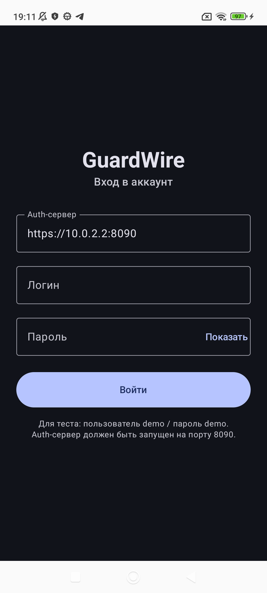
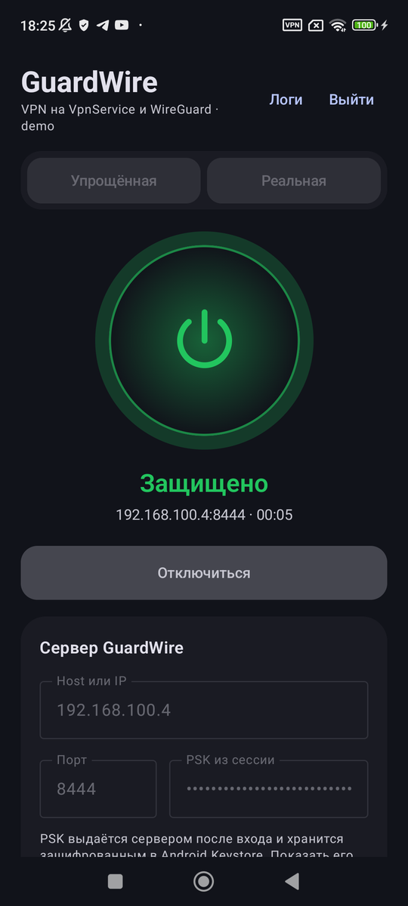
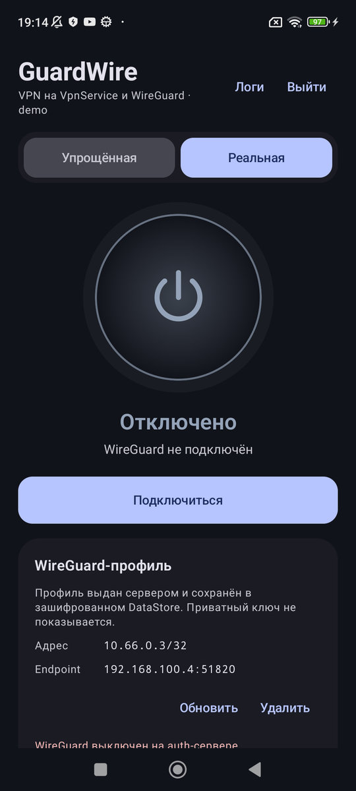
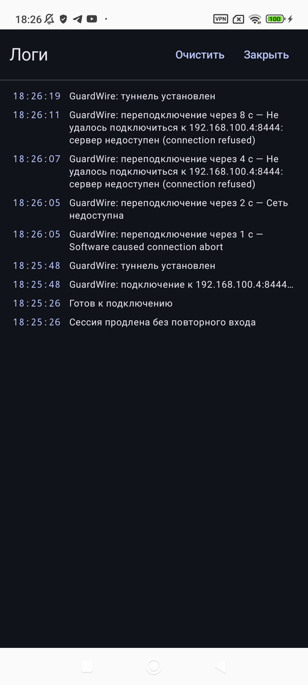

# GuardWire VPN

[](https://github.com/GoVad/TestVPNApp/actions/workflows/android.yml)

**Android VPN pet project.** Рабочий `VpnService`-клиент с TUN, foreground-сервисом,
двумя режимами, HTTPS-auth, access/refresh-токенами, автоматической выдачей
WireGuard-профиля, reconnect и always-on.

> ⚠️ **Это не production-VPN.** GuardWire/2 не проходил аудит. В проекте один
> сервер, один peer, локальный самоподписанный CA, нет kill switch и split
> tunneling. Не используйте его для реальной защиты трафика и не храните в нём
> настоящие секреты.

## Скриншоты

| Вход | Подключение |
|------|-------------|
|  |  |
| **WireGuard-профиль** | **Логи и reconnect** |
|  |  |

## Что это

Проект про то, как устроен VPN-клиент на Android, а не про «ещё один экран с
кнопкой»:

- `VpnService` + TUN + маршруты + DNS + `protect(socket)`;
- foreground-сервис, `onRevoke`, уведомление с кнопкой «Отключить»;
- учебный GuardWire/2 и реальный WireGuard через официальную библиотеку;
- auth over HTTPS с access/refresh, ротацией refresh и серверным logout;
- автоматическая выдача WireGuard-профиля без вставки `.conf`;
- reconnect при смене сети и always-on для GuardWire;
- модульная архитектура: `feature → domain → data/vpn`, use case-и, Hilt, Orbit;
- EN/RU UI и English-only диагностика Android-модулей.

## Что умеет

| Область | Статус |
|---------|--------|
| `VpnService`, TUN, foreground, `onRevoke` | ✅ |
| GuardWire/2 и реальный WireGuard | ✅ |
| HTTPS auth, access/refresh, logout/revoke | ✅ |
| Автоматический WireGuard-профиль | ✅ |
| Keystore-шифрование секретов | ✅ |
| Reconnect при смене сети | ✅ |
| Always-on | ✅ для GuardWire |
| EN/RU UI-строки | ✅ |
| Split tunneling, kill switch | ❌ вне демо |
| Несколько устройств, БД, control plane | ❌ вне демо |

## Как устроено

```text
:app
 ├── :feature:vpn → :core:domain → :core:model
 ├── :core:data   → :core:domain
 └── :core:vpn    → :core:domain
                  ├── :core:vpn:guardwire → :core:guardwire-protocol → :core:model
                  └── :core:vpn:wireguard
```

- `:core:domain` — контракты, модели и use case-и без Android.
- `:core:data` — DataStore/Keystore, auth-клиент, реализация store-контрактов.
- `:core:vpn` — тонкий фасад `VpnSession` и DI-сборка движков.
- `:core:vpn:guardwire` — учебный GuardWire/2: `VpnService`, TUN, always-on, reconnect.
- `:core:vpn:wireguard` — реальный WireGuard: `GoBackend`, разбор конфига, foreground-уведомление.
- `:feature:vpn` — Compose-экран, Orbit ViewModel, side effects.

## Быстрый старт: demo без root

Нужны JDK 17, Android SDK, Python 3 с `cryptography` и `openssl`.

```bash
# один раз: Python venv с cryptography
./tools/setup-python.sh

# HTTPS auth + GuardWire demo, локальный TLS-сертификат
./tools/demo-up.sh

# сборка и установка
./gradlew :app:assembleDebug
adb install -r app/build/outputs/apk/debug/app-debug.apk
```

Скрипт напечатает:

```text
Auth (HTTPS):  https://192.168.100.4:8090
GuardWire:     192.168.100.4:8444
Логин:         demo / demo
```

В приложении:

- auth-сервер: `https://<LAN_IP>:8090`;
- логин/пароль: `demo / demo`;
- в GuardWire-режиме host — `<LAN_IP>`, порт — `8444`.

Если `8090` занят:

```bash
AUTH_PORT=8091 DEMO_PORT=8444 ./tools/demo-up.sh
```

Demo-сервер проверяет handshake, кадры и UI, но **не маршрутизирует интернет**.
Для реального NAT нужен Linux-сервер ниже.

## Полный сервер с NAT

Linux, root, `iptables`:

```bash
# TLS-сертификат для auth-сервера (один раз)
./tools/gen-auth-cert.sh 192.168.100.4

# auth/control-plane без WireGuard
python3 tools/guardwire-auth-server.py \
    --host 0.0.0.0 --port 8090 \
    --user demo:demo --disable-wireguard

# GuardWire-сервер с TUN + NAT
sudo python3 tools/guardwire-linux-server.py \
    --host 0.0.0.0 --port 8443 \
    --auth-token-file tools/.guardwire-token
```

Для реального WireGuard:

```bash
sudo apt install wireguard-tools
sudo ./tools/wireguard-server-setup.sh

sudo python3 tools/guardwire-auth-server.py \
    --host 0.0.0.0 --port 8090 \
    --user demo:demo \
    --wg-interface wg0 \
    --wg-endpoint 192.168.100.4:51820
```

При входе auth-сервер сам выдаёт WireGuard-профиль и peer. Вставлять `.conf`
вручную не нужно. Если LAN-IP изменился, перегенерируйте сертификат:

```bash
./tools/gen-auth-cert.sh <новый_IP>
```

CA при этом переиспользуется, поэтому APK пересобирать не нужно, пока CA тот же.

## Ограничения и безопасность

- **GuardWire/2 — учебный протокол.** ECDH P-256 + HKDF + AES-GCM реализованы
  по базовым принципам, но не проходили аудит.
- **Один сервер и один peer.** Нет multi-device, IPAM, БД и нормального
  control plane.
- **Локальный CA.** HTTPS использует самоподписанный сертификат из
  `core/data/src/main/res/raw/auth_ca.pem`; это не публичный CA.
- **Нет kill switch, split tunneling и DNS leak protection.**
- **IPv6 намеренно отключён.**
- **Always-on только для GuardWire.** Для реального WireGuard не настроен.
- **Не production.** Не используйте для реальной защиты трафика, не храните
  настоящие токены и приватные ключи.

## Тесты и CI

```bash
./gradlew :core:domain:test :core:guardwire-protocol:test :app:assembleDebug :app:lintDebug
```

CI: [`.github/workflows/android.yml`](.github/workflows/android.yml) собирает
APK, запускает domain/protocol-тесты и lint на push/PR.

## Что посмотреть в коде

- [GuardWireVpnService.kt](core/vpn/guardwire/src/main/kotlin/com/haruchka/testvpnapp/core/vpn/guardwire/GuardWireVpnService.kt) — TUN, always-on, reconnect.
- [GuardWireTunnel.kt](core/vpn/guardwire/src/main/kotlin/com/haruchka/testvpnapp/core/vpn/guardwire/GuardWireTunnel.kt) — TUN ↔ GuardWire.
- [WireGuardController.kt](core/vpn/wireguard/src/main/kotlin/com/haruchka/testvpnapp/core/vpn/wireguard/WireGuardController.kt) — реальный режим.
- [AuthRepository.kt](core/data/src/main/kotlin/com/haruchka/testvpnapp/core/data/AuthRepository.kt) — HTTPS auth-клиент.
- [VpnViewModel.kt](feature/vpn/src/main/kotlin/com/haruchka/testvpnapp/feature/vpn/VpnViewModel.kt) — Orbit + use case-и.
- [core/guardwire-protocol](core/guardwire-protocol/src/main/kotlin/com/haruchka/testvpnapp/core/guardwire/protocol) — GuardWire/2.
- [tools](tools) — demo, auth, Linux NAT и WireGuard setup.
